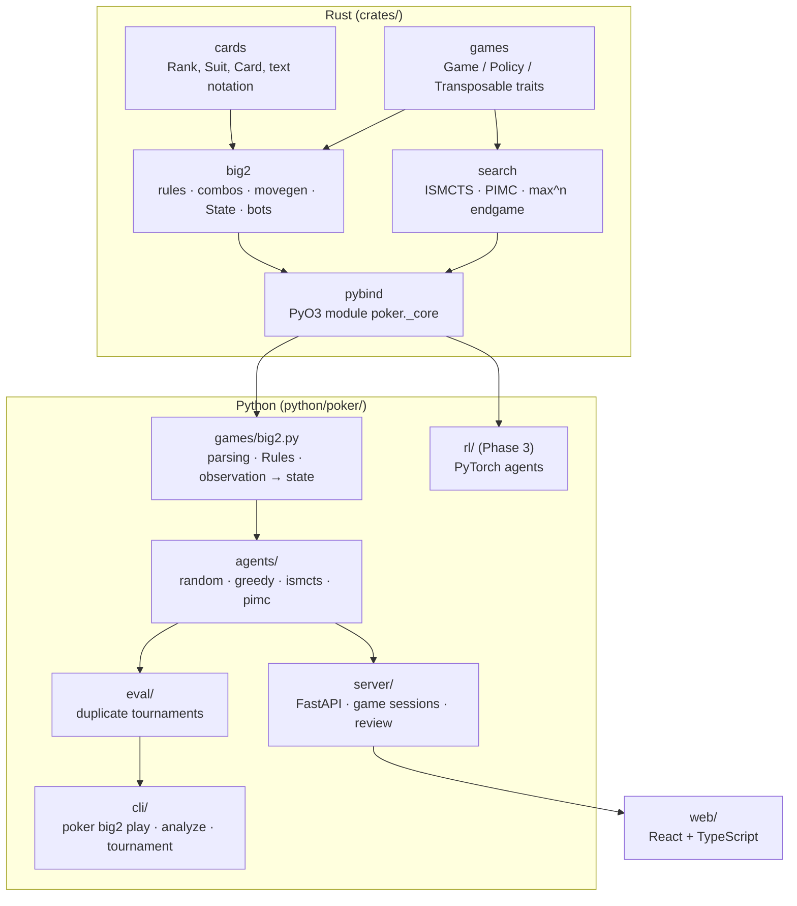

# Architecture

## Layers

**`crates/cards`** knows what a card is and how to write one (`"Ah"`, `"Tc"`), but
not how cards are ordered: that depends on the game.

**`crates/games`** defines the interface every game implements (`Game`): current
player, legal actions, apply, outcome, and `determinize` — sample hidden cards
consistent with one player's view. The search crate only talks to this trait, so a
second game (e.g. Hold'em) gets the solvers for free.

**`crates/big2`** is the Big Two engine. Hands are `u64` masks with card index
`rank*4 + suit` (ranks 3…2), so "higher index = stronger single". A combination's
strength is precomputed into one integer key, so "does X beat Y" is one comparison.
Move generation builds combinations from per-rank suit sets rather than testing
subsets. `docs/rules/big2.md` is the spec; tests cite its sections.

**`crates/search`** holds the solvers (see [solver.md](solver.md)). They return an
`Analysis`: every legal action with simulations, mean score, win rate and 95%
confidence intervals.

**`crates/pybind`** exposes all of the above to Python as plain values: card masks
are `int`, an action is the mask of cards played (`0` = pass), rules are keyword
strings. `python/poker/_core.pyi` documents and types it.

**`python/poker`** is everything above the engine: helpers, agents built from spec
strings (`"ismcts:iterations=2000"`), the tournament runner, and the CLI.

## Correctness strategy

| Layer | Check |
|---|---|
| Combination rules | Unit tests per rule-doc example; move generator vs brute-force subset search on random hands |
| Turn flow, scoring | Scenario tests per rule-doc section; property tests (cards conserved, zero-sum, termination) under random rule variants |
| Whole engine | Differential test against an independent pure-Python implementation (`python/tests/reference/`), checking the full legal-move set at every step (5,000 games agree) |
| Solvers | Endgame solver vs naive max^n; immediate wins found; reproducible with a seed; **identical output for positions that differ only in hidden cards** (the solver cannot peek) |

## Performance (Apple M1, one core)

| Operation | Speed |
|---|---|
| Random playout of a full deal | ~29 µs (~2.5 M moves/s) |
| Greedy playout of a full deal | ~18 µs |
| Legal moves, 13-card leading hand | ~2 µs |
| ISMCTS, 1,000 simulations (opening position) | ~20 ms |
