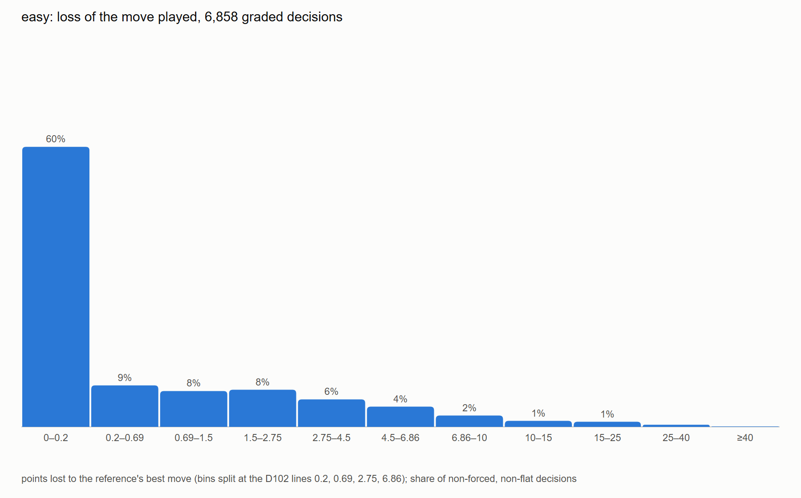
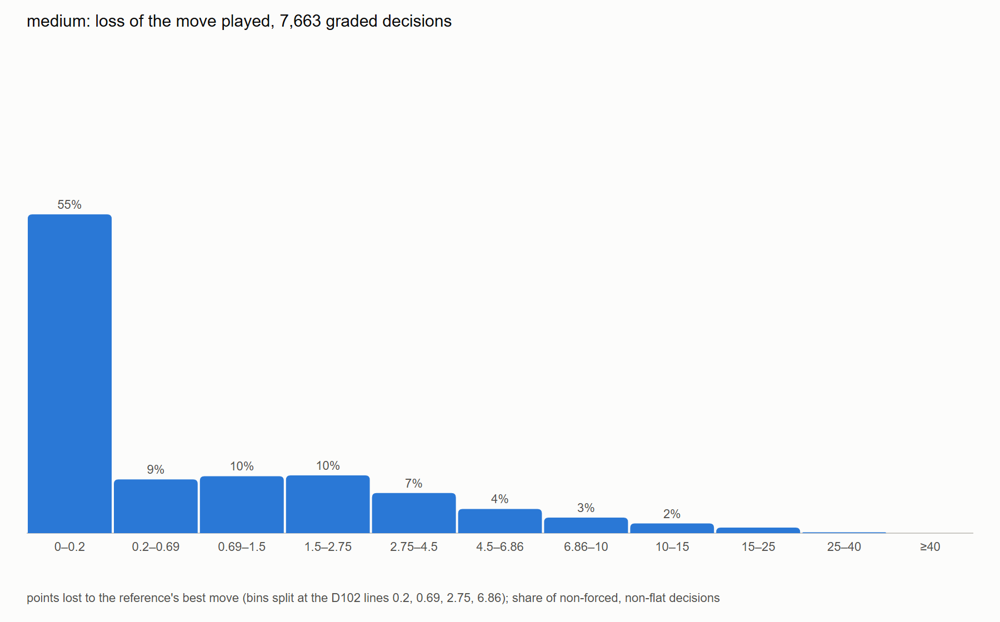
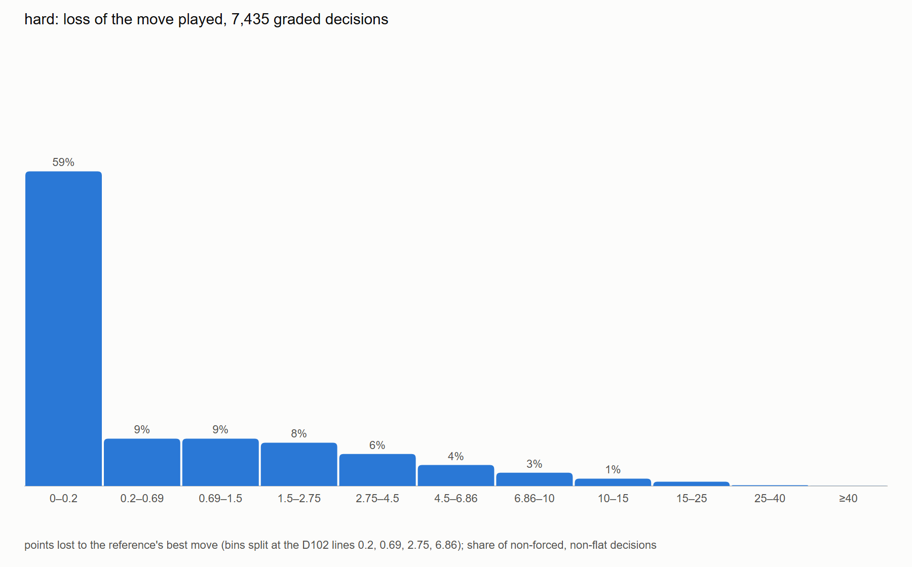
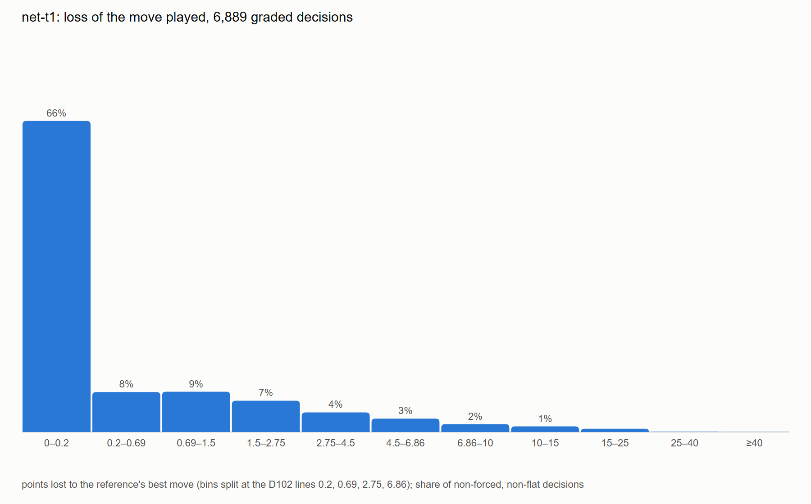
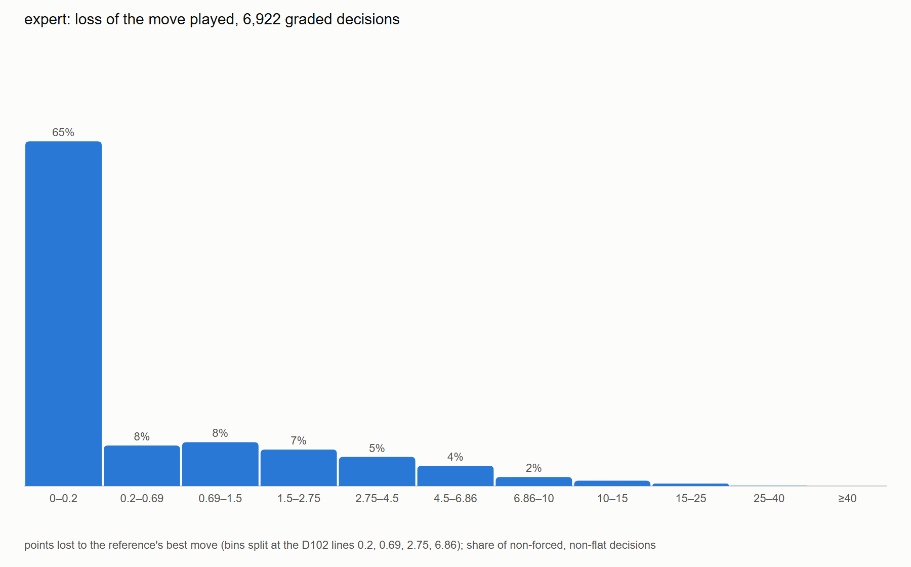
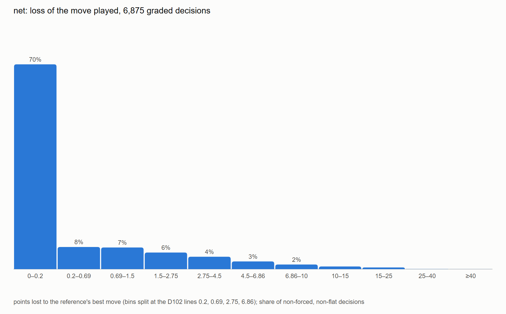

# Mistakes and their EV distributions per Elo band (plan Tasks 42a, 42)

## 0. Pilot (Task 42a)

Driver `experiments/mine_mistakes.py`, queue script `experiments/mine_mistakes_job.ps1`, tests
`python/tests/test_mine_mistakes.py`. Same-rung deals (all four seats one rung of
`runs/p6_ladder/ladder.json`), bands `net-t4.34` (1096), `easy` (1161), `net-t1` (1230), `net`
(1248); 100 deals per band. Every non-forced decision is searched by the provisional reference
(`netsearch k=8, n=256, depth=full`, widened to every move with prior >= 1 % plus the move
played) and the provisional knee (`k=3, n=64, depth=full`); the knee's pick is scored by the
reference's paired loss. Lines are D102 (0.2 / 0.69 / 2.75 / 6.86) read as upper limits of
great / good / inaccuracy / mistake. A puzzle candidate is a non-flat decision whose played
move lost at least 2.75, whose second-best move also loses at least 2.75 with its lead's 95 %
range above 0; `reasons` are empty (the theme comes from the structural rules of
`skill_for`), and no deeper confirmation solve yet (Task 44 does that).

**Cost, measured on a 1-deal-per-band smoke run (4 workers, one search thread each):**
reference 4.5-5.2 s and knee 0.5-0.9 s per non-forced decision; 42-57 % of decisions forced
(skipped). That is about 140 thread-s a deal, so 400 deals is about 15 thread-h, not the ~3
planned. Task 42 at 300 deals per band for ~6 bands with the deeper reference would be
several times that; its budget needs revisiting (cut deals per band or `n` first).

**Result (job 416, 100 deals per band, 40 min wall on 8 threads; `runs/p6_mistakes_pilot/summary.json`):**

| band (rung Elo) | decisions | forced | flat | played-move loss mean / p50 / p90 / p97 | share above 0.2 / 0.69 / 2.75 / 6.86 | knee picks a different best move | knee mean loss | ref s / knee s per decision |
|---|---|---|---|---|---|---|---|---|
| net-t4.34 (1096) | 5,729 | 46.5 % | 11.6 % | 2.22 / 0.26 / 6.35 / 13.48 | 51.2 / 43.6 / 24.5 / 8.7 % | 26.4 % | 0.218 | 1.65 / 0.23 |
| easy (1161) | 4,249 | 45.1 % | 6.6 % | 2.12 / 0.00 / 5.95 / 15.55 | 40.0 / 33.0 / 19.5 / 8.6 % | 25.3 % | 0.216 | 1.68 / 0.22 |
| net-t1 (1230) | 4,325 | 47.3 % | 9.4 % | 0.64 / 0.00 / 2.07 / 4.50 | 30.0 / 22.2 / 7.2 / 1.2 % | 26.6 % | 0.258 | 1.77 / 0.25 |
| net (1248) | 4,401 | 46.1 % | 9.8 % | 0.45 / 0.00 / 1.32 / 3.51 | 22.9 / 15.6 / 4.5 / 0.7 % | 24.1 % | 0.220 | 1.68 / 0.24 |

(Shares and losses are over non-forced decisions; seconds are per non-forced decision per
search thread.) Cost: the measured 140 thread-s a deal held up at about 1.7 s reference + 0.24 s
knee per labelled decision, so the 400 deals took about 11 thread-h on 8 threads, not the ~3
planned: Task 42 at 300 deals per band for ~6 bands with a deeper reference needs its budget cut
(200 deals per band first, as its notes say). Reading: the knee (k=3, n=64) names a different
best move than the reference on about a quarter of the non-forced decisions but costs only
0.22-0.26 points on average; about 46 % of decisions are forced and 7-12 % flat. The bands order
as expected on played-move loss (the 1096 and 1161 bands lose about 2.1-2.2 points a decision,
the 1230 and 1248 bands 0.45-0.64).

**Puzzle candidates** (`runs/p6_mistakes_pilot/candidates.json`, 60, 15 per band; every one has
theme, the bot's move, its loss and every answer's loss): themes `skill.b2_mixed` 20,
`skill.b2_stop_runner` 11, `skill.b2_singles_order` 11, `skill.saving_twos` 10,
`skill.b2_break_five` 5, `skill.when_to_pass` 3. `runs/` is git-ignored: `candidates.json` and
`summary.json` are committed with `git add -f`; `decisions.jsonl` (13.8 MB) stays in the
`big2-2` worktree's `runs/p6_mistakes_pilot/` and in this one, uncommitted.

## 1. Task 42: method (PUCT-2,000 reference, decisions 0010 and 0011)

- **Reference.** PUCT at 2,000 simulations on the hour-24 network, `c_puct` 2.5 (Task 52 has
  not ticked). Hidden cards come from the phase 3 belief network (`belief="net"`,
  `runs/p6_mistakes/belief-r1.pknn`, 2,048 candidate deals), which reads the play history.
  The exact information-set endgame applies at 12 or fewer hidden cards and 10 or fewer in all
  hands, with deals weighed by the same network. Each move graded gets its own search with the
  root fixed to that move (`analyze(root_move=...)`), with the same seed for each. The moves
  graded are those with prior at least 1 %, the top 8 by prior, and the move played. Loss =
  EV(best) - EV(move); loss SE = `hypot(se_best, se_move)`. `flat` = every move's loss is below
  0.2 or its 95 % range covers 0. There is no knee scoring (decision 0010).
- **Bands.** Every rung of Task 40's ladder except `random`, each table being four seats of
  one rung: `net-t4.34` (1096), `easy` (1161), `medium` (1200), `hard` (1222), `net-t1` (1230),
  `expert` (1236), `net` (1248).
- **File.** `runs/p6_mistakes/decisions-<band>.jsonl` uses the plan's shape (`game`, `deal_id`,
  `seat`, `band`, `rung_elo`, `position`, `legal_count`, `moves` = `[{action, ev, se, prior,
  loss, loss_se, rung_prob}]` best first, `played`, `loss`, `loss_se`, `forced`, `flat`,
  `reference`, `seed`). It also carries `turn`, `best`, `exact` and `seconds`, and the deal's
  full action history (`history`) on the deal's first line. `rung_prob` is exact for the
  network-prior rungs and is the network prior at τ = 1 for the others (`rung_prob_kind`).
- **Checks.** One decision in 20 is labelled again with a new seed (`repeat`) and with
  `belief="rules"` (`rules`); the report gives the share whose D102 word stays the same.
- **Cost.** A root-fixed search takes 0.17-0.34 s on one thread while the queue's other jobs
  run, so one graded decision is about 1.2-2.1 s. A deal is 27-89 s with labelling (about 60 s
  on average), so 7 bands x 300 deals is about 35 thread-h.

### 1.1 The 36 review puzzles regraded (hk-games review 2026-11-27)

`runs/p6_mistakes/review36-regraded.json` (`mine_mistakes.py review36`). Each puzzle's source
position was replayed from its deal with the full history, and every answer was graded by the
reference above.

- **B3-02** (deal 5574300040, turn 41; to beat 10♠, player 4 holds 4♠ A♠): J♣ stays best. Q♥
  loses 12.5 ± 0.5 points (was 19.0) and pass loses 7.6 (was 8.5); both are still blunders.
  Over 6 seeds Q♥'s loss ranged 11.6-14.7 at 2,048 belief candidates, and 8.4-16.2 at the
  default 256.
- **Best answer changes** in 8 of 36: B1-06, B1-09, B3-05, B3-08, B4-01, B4-05, B4-06, B4-09.
- **The bot's move is no longer a mistake** (loss under the 2.75 inaccuracy line) in 6:
  B3-07, B3-08, B4-01, B4-05, B4-06, B4-09. Under this reference these are not puzzles.
- **Grade words** change for 46 of the 194 answers. The reference's best move is always among
  the listed answers.
- **None used the exact endgame:** each puzzle has more than 10 cards in all hands.

## 2. Task 42: losses per band (jobs 439, 440, 441)

Seven bands, 300 same-rung deals each, every decision labelled by the §1 reference
(`runs/p6_mistakes/decisions-<band>.jsonl`, `report.md`, `table.json`). Every line passes
`mine_mistakes.validate42`, every deal's history is stored once, and every graded option carries
`rung_prob`. "Graded" = neither forced nor flat. Losses are in points, against the reference's best.

| band (rung Elo) | deals | decisions | forced | flat | graded | loss mean / p50 / p75 / p90 / p97 / p99 | share above 0.2 / 0.69 / 2.75 / 6.86 | same word: new seed / rules belief |
|---|---|---|---|---|---|---|---|---|
| net-t4.34 (1096) | 300 | 16,952 | 47.1 % | 3.2 % | 8,689 | 1.92 / 0.27 / 2.25 / 5.67 / 11.40 / 18.49 | 51.5 % / 42.2 % / 21.5 % / 7.4 % | 82.3 % (424) / 80.9 % (424) |
| easy (1161) | 300 | 13,159 | 46.4 % | 2.7 % | 6,858 | 1.49 / 0.00 / 1.27 / 4.39 / 9.84 / 19.70 | 40.0 % / 31.1 % / 15.5 % / 5.3 % | 86.3 % (350) / 83.1 % (350) |
| medium (1200) | 300 | 13,844 | 43.0 % | 2.9 % | 7,663 | 1.47 / 0.06 / 1.64 / 4.29 / 9.73 / 15.74 | 45.3 % / 36.1 % / 16.5 % / 5.4 % | 82.1 % (368) / 79.9 % (368) |
| hard (1222) | 300 | 13,096 | 41.5 % | 3.0 % | 7,435 | 1.33 / 0.00 / 1.25 / 4.01 / 9.21 / 14.82 | 40.8 % / 31.9 % / 14.8 % / 4.9 % | 83.5 % (399) / 81.2 % (399) |
| net-t1 (1230) | 300 | 13,472 | 47.3 % | 2.9 % | 6,889 | 1.00 / 0.00 / 0.74 / 2.92 / 7.75 / 13.49 | 34.2 % / 25.7 % / 10.6 % / 3.6 % | 88.1 % (369) / 82.9 % (369) |
| expert (1236) | 300 | 12,543 | 43.6 % | 2.2 % | 6,922 | 1.02 / 0.00 / 0.91 / 3.45 / 7.02 / 11.40 | 35.2 % / 27.5 % / 12.5 % / 3.2 % | 84.4 % (378) / 81.2 % (378) |
| net (1248) | 300 | 13,138 | 46.1 % | 3.0 % | 6,875 | 0.89 / 0.00 / 0.51 / 2.72 / 6.99 / 11.96 | 30.4 % / 22.9 % / 9.9 % / 3.1 % | 83.4 % (308) / 85.1 % (308) |

Pooled: the D102 word stays the same with a new seed in 84.2 % of relabelled decisions, and
with `belief="rules"` in 81.9 %. Cost: 1.26 s per graded decision on one thread; the exact
endgame answered 3.0 % of graded decisions. Neither the deal count nor the reference was cut.

- **Losses fall with rung Elo.** Mean loss goes from 1.92 (net-t4.34) to 0.89 (net), and the
  share above the 2.75 inaccuracy line from 21.5 % to 9.9 %. The order breaks only where the
  ladder's own Elo gaps are inside its noise: `easy` vs `medium` (1.49 vs 1.47 mean, but medium
  has more losses above 0.2) and `net-t1` vs `expert` (1.00 vs 1.02).
- **About 45 % of decisions are forced** (only one legal move, mostly pass) and 2-3 % are
  flat. Task 43's trivial rule removes roughly half of all decisions.
- **Even the top rung loses more than 2.75 points on about 10 % of graded decisions** under
  D102. That points to D102's lines being too tight for this reference; Task 43 fits new ones.
- **Repeatability is about 84 %.** One graded decision in six changes its D102 word on a new
  seed: the reference's own noise moves losses near a line across it. The rules-belief check changes the word in 18 %, only slightly
  more than reseeding does, so the history-aware belief moves single grades but not the band
  distributions much.
- **B3-02** is not in these deals. §1.1 stands: J♣ best, Q♥ loses 12.5.
- **Re-grade?** Task 52 kept `c_puct` 2.5, the weight used here, so it gives no reason to
  re-grade. Task 51 has not reported yet.

Histograms (loss of the move played, share of graded decisions, bins split at the D102 lines):

## 3. Task 49: sharp-decision pass rate

Run on Task 42's relabel (`experiments/sharp_pass.py`; 7 bands x 300 same-rung deals x 4 seats,
reference of §1; this replaces the 4-band, 100-deal pilot of §0). A decision is **sharp** when it
is not forced, not flat, and the second-best graded move loses at least 2.75 (D102's inaccuracy
line; Task 43 may move it). A deal-seat **passes** with at least 3 sharp decisions.

| band (rung Elo) | deal-seats | sharp decisions | seats with >=1 / >=2 sharp | **pass (>=3)** | pass rate | >=4 / >=5 | deals with a passing seat | passing seats, at most 2 per deal |
|---|---|---|---|---|---|---|---|---|
| net-t4.34 (1096) | 1,200 | 2,447 | 1,001 / 692 | **414** | 34.5 % | 216 / 84 | 255 | 375 |
| easy (1161) | 1,200 | 1,887 | 930 / 544 | **262** | 21.8 % | 99 / 37 | 182 | 248 |
| medium (1200) | 1,200 | 2,090 | 960 / 586 | **308** | 25.7 % | 141 / 67 | 211 | 291 |
| hard (1222) | 1,200 | 2,139 | 950 / 582 | **306** | 25.5 % | 154 / 76 | 212 | 291 |
| net-t1 (1230) | 1,200 | 2,082 | 953 / 596 | **302** | 25.2 % | 147 / 56 | 210 | 289 |
| expert (1236) | 1,200 | 1,962 | 917 / 563 | **281** | 23.4 % | 125 / 52 | 191 | 258 |
| net (1248) | 1,200 | 2,127 | 950 / 594 | **312** | 26.0 % | 155 / 76 | 214 | 294 |
| **all** | 8,400 | 14,734 | 6,661 / 4,157 | **2,185** | 26.0 % | 1,037 / 448 | 1,475 | **2,046** |

- **Projection to 300 deals a band: it is the measurement.** Task 42 already has 300 deals a
  band, so no scaling is needed: 2,185 deal-seats pass (2,046 when at most 2 seats per deal are
  kept, the sharp rule of Task E10), against the bar of 2,000. The bar is met, with only 2.3 %
  to spare on the capped count.
- **Per band the bar of 150 is met everywhere**: the lowest band (`easy`, 248 capped) has 1.65 times it.
  The share of passing seats is 22-35 %, highest in the weakest band.
- **Little headroom.** Task 50 will drop some of these (theme coverage needs 30 a theme on the
  headline decision, and positions must give a clean tree). If it cuts more than about 2 % of the
  capped count, 2,000 is missed: plan 100 more deals a band as a reserve (7 x 100 deals at about
  60 s a deal = 11.7 thread-h), rather than lowering the bar.
- Grade noise (§2: 84 % repeatability) moves some seats across the line; the count is stable to
  a few percent, not to the exact seat.

## 4. Task 50: branch exploration (method; results pending jobs 444-447)

Driver `experiments/branch_explore.py`, explorer `python/big2/teach/grading/branches.py`
(game-agnostic), queue script `experiments/branch_explore_job.ps1`.

- **Deal-seats.** §3's rule: 2,046 (at most 2 a deal).
- **Stand-in player.** The band rung's own move probabilities over every legal move: exact
  for `net-t4.34` and `net-t1` (softmax of log prior / τ); the network prior at τ = 1 for
  the search rungs and for `net` (τ = 0 would be deterministic, so the main line alone
  would cover everything; orchestrator's call, 2026-11-28).
- **Growing the tree.** First the main line (the source deal; its grades are §2's, they
  count toward the cap). Then, best first, the unexplored own move with the highest path
  probability is played. The band's bots answer it (a fresh agent seeded from the deal seed,
  seat and number of actions, so a branch replays from its history alone) up to the seat's
  next decision, which is graded by §1's reference. Forced decisions are free and outside
  the cap. The run stops at 90 % coverage or at the cap.
- **Coverage.** The probability that a stand-in player's whole path, from the seat's first
  decision to the deal's end, meets only graded decisions. The order does not depend on
  the cap, so the pilot at cap 80 also gives caps 20 and 40 (its prefix).
- **File.** `runs/p6_branches/<run>/trees.jsonl`, one deal-seat a line: `coverage`,
  `coverage_main`, `curve` (graded, coverage), `graded`, `seconds`, and `nodes` keyed by
  hk-games `deal_puzzles.history_hash` (checked equal on a real tree). Each node holds
  `turn`, `history`, `path_p`, `main_line`, `children` (own move -> key or `end`),
  `trivial`, `theme` (the existing tagger), `exact`, `elo: null` (Task 44 fits it,
  orchestrator's call 2026-11-28), and `options` (app action, `loss`, `loss_se`, `grade`
  under D102, `ev`, `se`, `prior`, `rung_prob` of the stand-in, `rung_probs` for τ 4.34 and 1).
- **Smoke** (2 deal-seats, cap 12): 1.5 s a new grade on one thread. The `expert` band's
  bots took about 6 s a deal-seat. The `expert` seat went from 0.3 % coverage on the main
  line (its bot took a 1 %-prior move early) to 62 % at 9 grades. The `net-t4.34` seat
  stayed at 0 %: at τ 4.34 the stand-in is close to uniform over dozens of legal moves, so
  that band cannot reach 90 % at any practical cap.
- **Jobs** (cpu): 444 pilot (100 deal-seats, cap 80), 445 its report
  (`runs/p6_branches/pilot/report.md`), 446 full run at cap 40, 447 its report.
